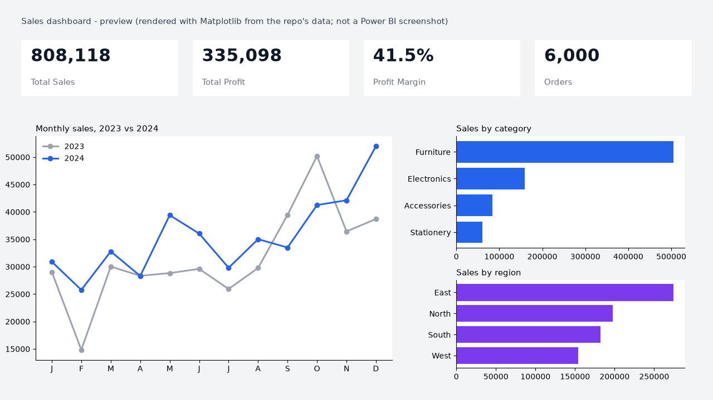

# Sales Dashboard (Power BI)

A Power BI project built on a **star schema**: reproducible sample data, a documented data model, DAX measures,
Power Query steps and a dashboard specification. The sales data is **synthetic** (see `generate_data.py`) and is not
from a real company.

## Preview

> **This is not a Power BI screenshot.** It is a preview drawn with Matplotlib from this repo's data (same KPIs as `validate.py`) to show the intended layout. Replace it with a screenshot of the real report once the `.pbix` is built.

## Contents
| Path | What it is |
|---|---|
| `data/` | `fact_sales.csv` (6,000 orders), `dim_product.csv` (24 products), `dim_customer.csv` (250 customers) |
| `generate_data.py` | Seeded generator for the data (reproducible) |
| `validate.py` | Pandas reference numbers to cross-check the DAX measures |
| `docs/data_model.md` | Star-schema diagram, relationships and data-quality checks |
| `docs/power_query.m` | Power Query (M) steps for loading and typing each table |
| `docs/dax_measures.dax` | Measures: sales, profit, margin, YoY, YTD, rolling 3M, share, rank, discounts, `dim_date` table |
| `docs/dashboard_spec.md` | Page-by-page visual specification and publishing checklist |
| `powerbi/` | *Add `SalesDashboard.pbix` here* |
| `docs/screenshots/` | *Add report screenshots here* |

## How to build the report
1. `pip install pandas numpy` then `python generate_data.py` (or use the CSVs already in `data/`).
2. Power BI Desktop > **Get data** > Text/CSV for the three files. Use the queries in `docs/power_query.m`.
3. Model view: create the relationships in `docs/data_model.md`.
4. Create the `dim_date` table and measures from `docs/dax_measures.dax`; mark `dim_date` as a date table.
5. Build the two pages described in `docs/dashboard_spec.md`.
6. Run `python validate.py` and confirm the headline cards match.

## Skills demonstrated
Data modelling (star schema, relationships), Power Query transformations, DAX (iterators, `CALCULATE`, time intelligence,
`RANKX`, `TOPN`), KPI design, and data validation against an independent calculation in Python.

## Status
- [x] Data, model, DAX, Power Query and specification
- [ ] `.pbix` report and screenshots (to be added)
